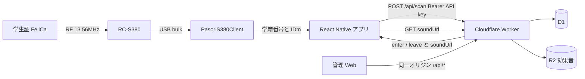

# lab-student-card-reader

真鍋研の入退室システムです。Android タブレットに挿した Sony PaSoRi RC-S380 で学生証（FeliCa）を読み、Cloudflare 上の入退室 API に学籍番号を送ります。

調査メモ: [docs/implementation-plan.md](docs/implementation-plan.md)

## 技術スタック

| 層 | 技術 | 役割 |
|---|---|---|
| カード | FeliCa / RC-S380 | 学生証の非暗号化領域から学籍番号を読む |
| 端末アプリ | React Native 0.87 + Kotlin Native Module | 待受 UI、USB 読取、API 送信、効果音再生 |
| QR | Google Play services code scanner | Web が発行した API 設定 QR をカメラで読む |
| API / Web | Cloudflare Workers | 入退室トグル、在室リスト、ダッシュボード、設定画面 |
| DB | Cloudflare D1 | メンバー、来室履歴、API キー、デフォルト効果音設定 |
| 音声 | Cloudflare R2（未有効） | 入室 / 退室の効果音ファイル |
| 解析 | Python + nfcpy + uv | Mac 上で RC-S380 を探してカードダンプする |
| ツールチェーン | mise | JDK / Node / Python / uv / Android SDK |
| CI | GitHub Actions | 型チェック、テスト、debug APK、`release/v*` で APK 公開 |

日付と在室判定は Asia/Tokyo です。在室リストは退室していない人を残し、日本時間の午前 2 時を過ぎると落ちます。サーバーへ退室イベントは送りません。

## ディレクトリ

| パス | 中身 |
|---|---|
| `app/` | タブレット用 React Native アプリ |
| `app/android/.../pasori/` | RC-S380 USB / FeliCa と QR / 音声の Kotlin モジュール |
| `worker/` | Cloudflare Workers + 静的 Web UI |
| `tools/` | Mac 用 nfcpy プローブ / ダンプ |
| `dumps/` | 実カード解析結果。gitignore。コミットしない |

## 通信の流れ



読取時の処理はだいたい次のとおりです。

1. タブレットが RC-S380 を USB Host で開き、FeliCa Polling(`0x8277`) のあと Read Without Encryption(`0x010B`, block 0) を叩く。
2. Kotlin は ASCII の学籍番号（例: `AE19051`）と IDm だけを JS に渡す。カードプロトコルは JS に出さない。
3. アプリは `POST /api/scan` に `studentId` / `idm` / `deviceId` を送る。認証は `Authorization: Bearer ltn_...`。
4. Worker は前回イベントを見て入室か退室かを決め、`visits` に書き、表示名と効果音 URL、いま在室の人を返す。
5. アプリは中央に名前と入室/退室を出し、右側の在室リストを更新する。`soundUrl` があれば native の MediaPlayer で再生する。
6. 在室リストは 15 秒ごとに `GET /api/present` でも取り直す。午前 2 時 JST を過ぎた未退室はリストから消える。

管理 Web は同じ Worker の静的ファイルです。ダッシュボードは `GET /api/dashboard`、設定はメンバー・効果音・API キーを `/api/members` `/api/sounds/*` `/api/api-keys` で扱います。Web の認証はまだ Cloudflare Access 前なので、API キー発行画面も同じオリジンに出ています。

アプリへの API 設定は次のどれかです。

- 設定画面でキーを発行し、出た QR をアプリの歯車 > 「カメラで QR を読む」
- 同じ JSON を手貼り
- ビルド時の `LAB_API_BASE_URL` / `LAB_API_KEY` / `LAB_DEVICE_ID`（通常は空のまま、端末側で入れる）

QR の中身:

```json
{
  "v": 1,
  "apiBaseUrl": "https://your-worker.example",
  "apiKey": "ltn_...",
  "deviceId": "tablet-1"
}
```

リーダーを持っていないときは、設定のデモ送信（パスワード `test`）で任意の学籍番号を同じ `/api/scan` に送れます。

## 学生証の読み方

RC-S380 の公式対応 OS は Windows のみです。Android では USB bulk デバイスとして扱います。VID `0x054C`、PID `0x06C1`（RC-S380/S）または `0x06C3`（RC-S380/P）。

最初の実カードでは、学籍番号は非暗号化領域にありました。

| 項目 | 値 |
|---|---|
| システムコード | `0x8277` |
| サービスコード | `0x010B` |
| block 0 | `002AE19051030000` |
| 使う | `AE19051`（index 3..9） |
| 捨てる | 先頭 `00`、その次の `2`、後ろの `03`、末尾ゼロ |

## 使い方

### Mac でカードを解析する

必要: RC-S380、データ対応 mini-USB、mise、Homebrew の libusb。

```sh
mise trust
mise install
mise run setup
mise run probe
mise run dump
```

成功条件は、probe が RC-S380 を見つけ、`dumps/` に JSON が書け、`0x8277` / `0x010B` / block 0 から `AE19051` 形式が取れることです。学籍番号は個人情報なので Git に入れないでください。

### タブレットアプリ

```sh
mise run android
```

RC-S380 を挿して USB 権限を許可し、学生証をタッチします。API 未設定なら歯車から QR を読みます。

### Worker

```sh
cd worker
npm install
npx wrangler d1 migrations apply lab-attendance --remote
npx wrangler deploy
```

ダッシュボードは `/`、設定は `/settings/` です。効果音用 R2 は Cloudflare ダッシュボードで R2 を有効化したあと、bucket `lab-attendance-sounds` を作って `wrangler.jsonc` の binding を戻してください。今は未有効なので音声アップロードは 503 になります。

## CI / Release

`main` と pull request で、アプリの型チェック / Jest、Worker の型チェック、Python compile、Android debug APK を回します。

APK は `release/v*` タグで GitHub Release に出ます。

```sh
git tag release/v0.1.0
git push origin release/v0.1.0
```

`release/v1.2.3` なら `versionName=1.2.3`、`versionCode=10203` です。いまの署名は debug keystore です。API キーは APK に焼き込まず、端末側で入れます。
